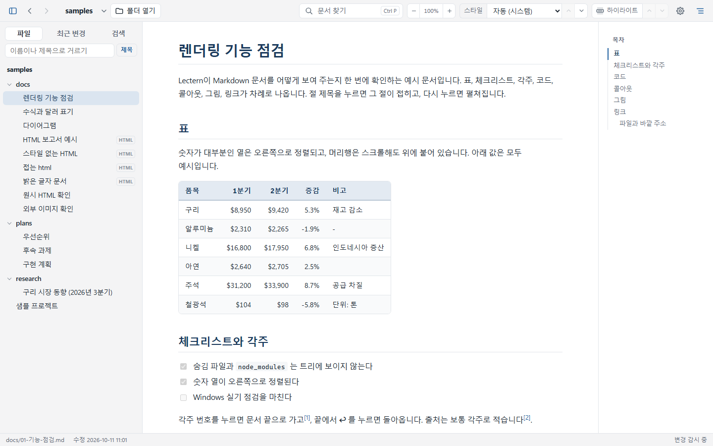
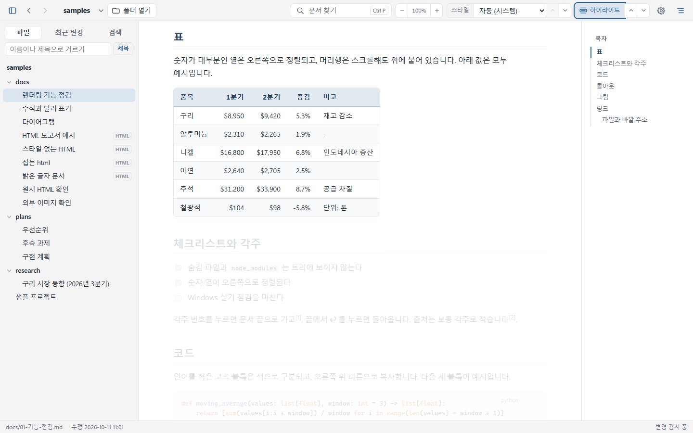
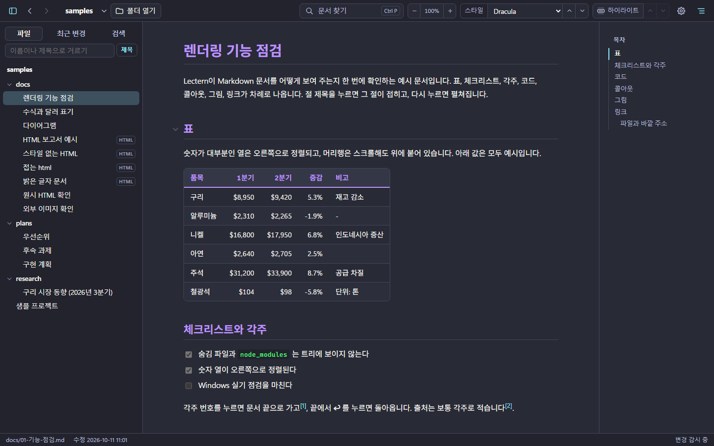

# Lectern (렉턴)

Claude Code·Claude 가 프로젝트 폴더에 만든 문서(Markdown·HTML)를 **사람이 한눈에 훑어보고 읽기 위한** Windows용 문서 뷰어입니다.
보기 전용이라 문서를 고치거나 지우지 않고, 인터넷에 연결하지 않고 PC 안에서만 동작합니다 (문서 속 인터넷 그림만 예외, 설정에서 끌 수 있음).

## 내려받기

**[최신 판 내려받기 (Releases)](https://github.com/samiblog/lectern-download/releases/latest)** — `Lectern-버전-setup.exe`

## 설치

1. 내려받은 `Lectern-버전-setup.exe` 를 실행합니다. 관리자 권한 없이 지금 사용자에게 설치됩니다.
2. **'Windows의 PC 보호'** 파란 창이 뜨면 **추가 정보 → 실행** 을 누릅니다. 코드 서명을 하지 않은 프로그램이라 인터넷에서 받은 설치 파일을 처음 실행할 때 나오는 안내입니다.
3. 설치가 끝나면 시작 메뉴의 **Lectern** 으로 실행하거나, 탐색기에서 폴더를 우클릭해 **Lectern으로 열기** 를 고릅니다 (Windows 11 은 '더 많은 옵션 표시' 안).

- 필요한 것: Windows 10/11 (64비트), Microsoft Edge WebView2 런타임 — Windows 11 에는 기본으로 있고, 없으면 설치 프로그램이 알려 줍니다.
- 새 판은 같은 방법으로 덮어 설치하면 됩니다. 설정(최근 폴더, 스타일)은 그대로입니다.
- 제거: Windows 설정 → 앱 → 설치된 앱 → Lectern. 설정 파일(`%APPDATA%\Lectern`)은 남깁니다.

## 할 수 있는 것

- 폴더를 열면 파일명 대신 **문서 제목으로 보이는 트리**와 **폴더 개요**(방금 바뀐 문서, 문서별 요약)
- 표·코드·수식·Mermaid 다이어그램·콜아웃·각주, Claude 가 만든 **HTML 보고서**(스크립트는 막고 문서만)
- 문서가 바뀌면 1초 안에 다시 그리고 **바뀐 곳을 표시**
- 전체 검색(Ctrl+Shift+F), 문서 안 찾기(Ctrl+F), 빠른 열기(Ctrl+P), 목차, 제목을 눌러 절 접기
- **스타일 24종**(용도별·분위기별·밝기별로 묶어 보기), **글자 크기** 조절, 한 장만 또렷하게 보는 **장 하이라이트**
- 본문 우클릭: 원문·표·그림 복사, Claude Code 프롬프트에 붙여 넣을 위치(`@docs/보고서.md 40~52행`) 복사

| 장 하이라이트 | 어두운 스타일 (Dracula) |
|---|---|
|  |  |

## 사용 조건

- 누구나 **무료로** 사용할 수 있습니다 (개인·업무 용도 모두).
- 있는 그대로 제공되며, 사용으로 생긴 문제에 대해 보증이나 책임을 지지 않습니다.
- 이 저장소에는 설치 파일과 안내만 있습니다.

## 포함된 오픈소스

설치 파일에는 Python, pywebview, Flask, watchdog, markdown-it, Mermaid, KaTeX, highlight.js, DOMPurify 등 오픈소스 소프트웨어가 들어 있습니다.
각각의 저작권 표시와 라이선스는 [THIRD-PARTY-NOTICES.md](THIRD-PARTY-NOTICES.md) 에 있습니다.
